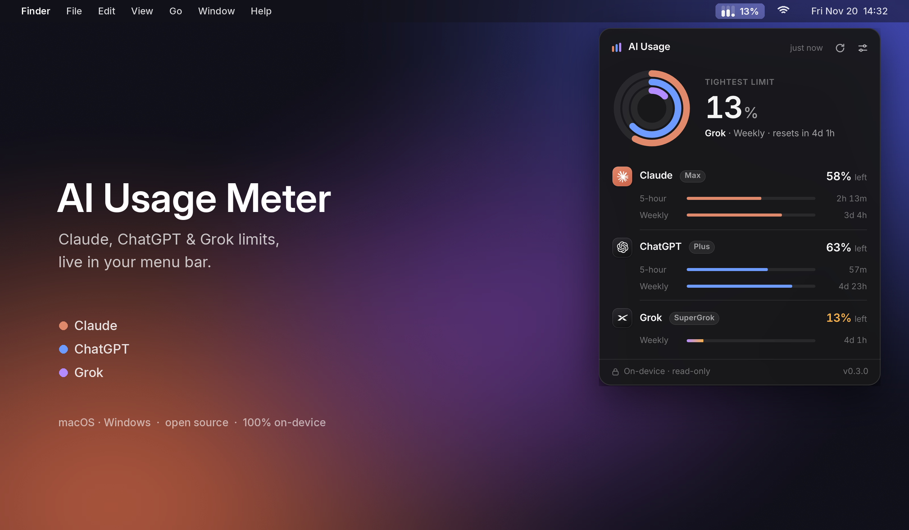

<div align="center">


# AI Usage Meter

**Claude、ChatGPT（Codex）、Grok 的订阅额度，常驻菜单栏，一眼看清。**

中文 · [English](./README_EN.md)

[](https://github.com/TTNAN/ai-usage-meter/actions/workflows/build.yml)
[](https://github.com/TTNAN/ai-usage-meter/releases)

[](./LICENSE)

<picture>
  <source media="(prefers-color-scheme: light)" srcset="docs/hero-light.png" />
  
</picture>

</div>

写代码写到一半被「额度用完」打断？AI Usage Meter 把三家的 5 小时窗口、周额度和重置倒计时放进菜单栏，**不用打开网页、不用粘贴 Cookie、不经过任何服务器**。

## 亮点

- **一眼看清最紧张的那一个** — 三环总览 + 大号数字，直接告诉你哪家额度最先见底、多久后重置。
- **菜单栏图标本身就是仪表** — 三根小电量条实时显示各家剩余额度；macOS 上还可以在图标旁直接显示百分比。
- **每个窗口都看得到** — Claude 的 5 小时 / 本周（以及 Opus、Sonnet 单独额度）、ChatGPT 里 Codex 的 5 小时 / 本周、Grok 的计费周期，各自带倒计时。
- **订阅档位** — 自动识别 Max、Pro、Plus、SuperGrok 等档位。
- **零配置** — 直接复用 ChatGPT 桌面版（Codex）、Claude Code、Grok Build 已有的登录；只用 Claude / Grok 网页版或 App？在设置里登录一次账号就行。
- **实时跟着变** — 后台每 1 到 5 分钟自动重读，你在网页、App、命令行哪里用掉的额度都会同步显示。
- **原生质感** — macOS 原生毛玻璃弹窗、跟随系统深浅色、点击图标弹出、失焦自动收起；Windows 上从托盘弹出。
- **中英双语** — 跟随系统语言，也可在设置里切换。
- **安静可靠** — 后台低频轮询、手动刷新有限速；单次请求失败会保留上次读数并标注，绝不编造数字。
- **轻** — Tauri v2 + 原生 HTML/CSS/JS，没有 Node 依赖，没有前端打包器。

<p align="center"></p>

## 安装

从 [Releases](https://github.com/TTNAN/ai-usage-meter/releases) 下载：

| 平台 | 文件 | 说明 |
| --- | --- | --- |
| macOS（Apple 芯片 + Intel） | `.dmg` | 拖进「应用程序」。尚未公证，首次打开请右键 → 打开，或运行下方命令 |
| Windows 10 / 11 | `.exe` 或 `.msi` | 双击安装，无需管理员权限 |

```bash
xattr -d com.apple.quarantine "/Applications/AI Usage Meter.app"
```

然后登录你在用的工具（用哪个登哪个，没登录的会显示「未连接」）：

| 服务 | 最简单的方式 | 也可以 |
| --- | --- | --- |
| Claude | 点 Claude 一行的「登录账号」（或 设置 → Claude 账号），登录 claude.ai | 已装 [Claude Code](https://docs.anthropic.com/en/docs/claude-code) 的话自动读取 |
| ChatGPT（Codex 额度） | 在 [ChatGPT 桌面版](https://openai.com/chatgpt/download/) 里打开 Codex 并登录 | [Codex CLI](https://github.com/openai/codex) `codex login` |
| Grok | 点 Grok 一行的「登录账号」（或 设置 → Grok 账号），登录 grok.com | 已装 [Grok Build](https://docs.x.ai/build/overview) 的话自动读取 |

> Claude 网页版、桌面版、手机版和 Claude Code 共用同一份额度；Grok 网页版、App 和 Grok Build 也共用同一个每周额度池。所以登录任意一处，看到的都是同一个数字。登录窗口里如果 Google 登录被拦截，换邮箱登录即可。

## 快捷键

| 按键 | 作用 |
| --- | --- |
| `⌘R` / `Ctrl R` | 刷新 |
| `⌘,` | 打开设置 |
| `Esc` | 收起弹窗 |
| `⌘Q` / `Ctrl Q` | 退出 |

## 工作原理

三家目前都没有公开的「订阅额度」API，所以 AI Usage Meter 读取各家官方应用自己在用的接口：要么复用官方 CLI / 桌面版已保存在本机的登录，要么用你在应用里登录的网页账号。

| 服务 | 接口 | 凭证位置 | 轮询 |
| --- | --- | --- | --- |
| Claude | `GET api.anthropic.com/api/oauth/usage` | macOS 钥匙串 `Claude Code-credentials`，或 `~/.claude/.credentials.json` | 5 分钟 |
| ChatGPT（Codex） | `GET chatgpt.com/backend-api/wham/usage`；读不到登录或请求失败时，改读 `~/.codex/sessions` 里最近一次会话记录的额度 | `~/.codex/auth.json`（ChatGPT 桌面版与 Codex CLI 共用，支持 `$CODEX_HOME`） | 1 分钟 |
| Grok | `GET cli-chat-proxy.grok.com/v1/billing` | `~/.grok/auth.json`（支持 `$GROK_HOME`） | 5 分钟 |
| Claude 网页账号 | `GET claude.ai/api/organizations/{org}/usage` | 应用内登录窗口的 claude.ai 会话 | 3 分钟 |
| Grok 网页账号 | grok.com 用量页自己请求的 `GetGrokCreditsConfig` | 应用内登录窗口的 grok.com 会话 | 5 分钟 |

网页账号的请求在一个隐藏的窗口里、在对方网站自己的页面内发出（和你在浏览器里打开用量页一样），结果交回应用后显示。会话 cookie 只留在应用自己的浏览器存储里，不会被读出、复制或发往别处；在设置里点「已登录」即可退出并清除。

> [!NOTE]
> 2026 年 7 月起 Codex 桌面版并入了 ChatGPT 桌面版，所以这一行叫 ChatGPT。它显示的是 **Codex 的用量额度**，不是 ChatGPT 聊天的额度，两者分开计算。
>
> Claude 和 Grok 两行，CLI 登录和网页账号都能用，两者都有时优先用 CLI，读不到再用网页账号。

## 隐私

- 凭证只在发请求的那一刻从本机读取，只发给它所属的那家服务，不落盘、不上传。
- 只发查询用量的只读请求，不会改动你的账号或 CLI 配置文件。
- 没有服务器、没有统计、没有遥测。代码就这几百行，欢迎审阅：[`providers.rs`](src-tauri/src/providers.rs)、[`web.rs`](src-tauri/src/web.rs)。

## 风险说明

这些都是非官方 / 内部接口，随时可能变化，届时对应一行会显示「暂时连不上」，而不是错误的数字；以各家官方设置页为准。低频只读轮询的风险较低，目前没有因此封号的公开案例，但我们无法保证。

## 参与开发

不装 Rust 也能改界面：用任意静态服务器打开 `src/`，页面会自动进入预览模式并使用演示数据。

```bash
python3 -m http.server -d src 8000
# http://localhost:8000/?state=empty   首次启动
# http://localhost:8000/?view=settings 设置页
```

构建桌面应用需要 Rust stable：

```bash
cargo install tauri-cli --version "^2"
cargo tauri dev                    # 开发
cargo tauri build                  # 打包
cd src-tauri && cargo test         # 单元测试
AI_USAGE_METER_MOCK=1 cargo tauri dev   # 用演示数据运行
```

想支持更多服务（Gemini CLI、Cursor、Copilot…）？欢迎提 [Issue](https://github.com/TTNAN/ai-usage-meter/issues) 或 PR：每个服务只是 `providers.rs` 里的一个函数。

## 路线图

- [ ] 额度即将用尽时的系统通知
- [ ] 更多服务：Gemini CLI、GitHub Copilot、Cursor
- [ ] 用量历史迷你走势图
- [ ] Linux 托盘
- [ ] macOS 签名与公证

## 致谢

- [@Litx4i](https://x.com/Litx4i/status/2123400444458488080) — 灵感来源
- [Quota](https://github.com/josephbergvinson/quota) — 复用 CLI 登录状态的思路

如果它帮你省下了一次「额度用完」的打断，欢迎点个 ⭐️，这是让它继续变好的最大动力。

## 请我喝杯咖啡

如果这个项目帮你省了点时间，欢迎请我喝杯咖啡。☕

| 微信赞赏码 |
| -------- |
|  |

## 许可证与商标

[MIT](./LICENSE)。Claude 是 Anthropic 的商标；OpenAI / ChatGPT / Codex 是 OpenAI 的商标；Grok / xAI 是 xAI 的商标。品牌图标仅用于标识对应服务，不代表任何背书。截图使用演示数据。
