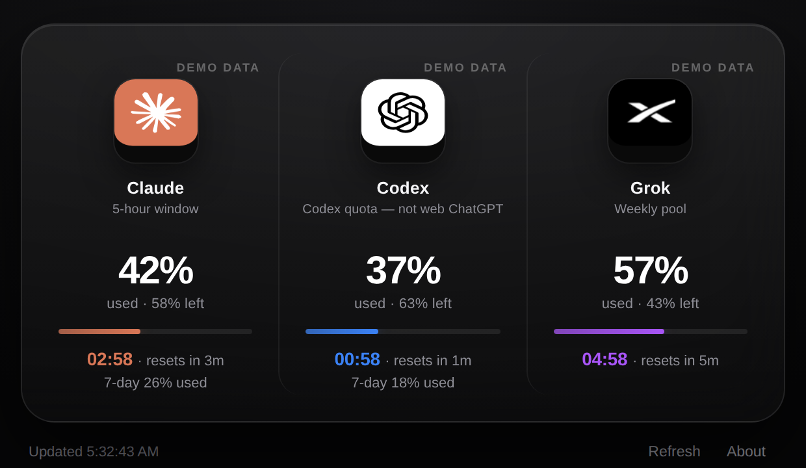

English | [English](./README_EN.md)

# AI Usage Meter

> 一个常驻菜单栏 / 系统托盘的小窗口，像黑色 Dock 一样，把 Claude、Codex、Grok 三个 AI 的用量一眼看清。



## 灵感来源

2026 年 11 月 19 日，[@Litx4i](https://x.com/Litx4i) 在 X 上发了一条帖子：「为什么 ai 软件图标不能这样设计呢」，配了一段 GIF：一个黑色 Dock 里，三个 AI 图标本身就是用量表。

原帖：https://x.com/Litx4i/status/2123400444458488080

这个项目就是把那个想法做成真的：一个小窗口，三个图标，三条用量进度条。

## 它是什么

AI Usage Meter 是一个 Tauri v2 应用（Rust + 原生 HTML/CSS/JS，无打包器），macOS 上常驻菜单栏，Windows 上常驻系统托盘。

窗口里有三张卡片：

| 服务 | 图标颜色 | 显示内容 |
| --- | --- | --- |
| Claude | 橙色 `#D97757` | 已用 %、剩余 %、用量条、重置倒计时 |
| Codex | 蓝色 `#3B82F6` | 已用 %、剩余 %、用量条、重置倒计时 |
| Grok | 紫色 `#A855F7` | 已用 %、剩余 %、用量条、重置倒计时 |

- 重置倒计时每秒刷新。
- 托盘图标的提示文字（tooltip）直接显示三家的用量摘要，不用打开窗口也能一眼看到。
- 点击托盘图标可以打开 / 收起窗口。

## 同步方式：只自动同步

v1 只有自动同步：读取你本机上三个官方 CLI 已经登录的状态，直接向各家接口查询用量。

没有手动输入用量这个主流程。如果你还没有登录某个 CLI，对应卡片会显示「未连接」（Grok 未登录时即如此）；如果三个都没登录，界面会显示 DEMO DATA 标记，用原帖里的 37 / 42 / 57% 数字仅作演示，不代表真实用量。

## 各服务怎么查

| 服务 | 接口 | 凭证来源 | 轮询间隔 |
| --- | --- | --- | --- |
| Claude | `GET https://api.anthropic.com/api/oauth/usage` | `~/.claude/.credentials.json` 里的 Claude Code OAuth token，请求头 `anthropic-beta: oauth-2025-04-20` | ≥ 5 分钟 |
| Codex | `GET https://chatgpt.com/backend-api/wham/usage` | `~/.codex/auth.json` 里的 Codex OAuth token，请求头 `chatgpt-account-id` | 60 秒 |
| Grok | `GET https://cli-chat-proxy.grok.com/v1/billing?format=credits` | `~/.grok/auth.json` 里的 token，请求头 `x-xai-token-auth: xai-grok-cli` | 5–10 分钟 |

- Claude 返回 `five_hour.utilization`、`resets_at` 和 `seven_day`。
- Codex 返回 `primary_window`（5 小时）和 `secondary_window`（7 天）的 `used_percent` 与 `reset_at`。
- Grok 返回 `config.creditUsagePercent`（已用比例）和 `currentPeriod`（按周计费周期）。

> ⚠️ Codex 这里显示的是 **Codex CLI 的用量额度，不是 ChatGPT 网页版聊天的额度**。两者不是同一个额度，请不要混淆。

## 登录与隐私

- v1 只复用官方 CLI 的登录状态：先装好 Claude Code、Codex CLI、Grok CLI，各自登录一次即可。
- 不需要密码，不需要粘贴 Cookie。
- Token 只在调用时从磁盘读取，应用不会把它写到任何地方，也不会上传。
- 只发只读的 GET 请求。如果某个接口请求失败，对应卡片显示「Unavailable」，绝不编造数字。
- 本地运行，没有服务器，没有统计分析，没有上传。

## 风险说明

请先了解再使用：

- 这三个都是非官方 / 内部接口，目前没有官方的订阅用量 API。接口随时可能变化，也可能要求你重新登录。
- 各家设置页面上的数据才是权威的。
- 低频只读轮询的风险相对较低，但不是零风险。目前没有公开案例表明仅因用量轮询就封号，但我们不承诺「永远不会被封」。

## 安装

### macOS

从 Releases 下载 `.dmg` 安装。v1 尚未签名（没有付费的 Apple Developer 公证），首次启动时：右键点击应用 > 打开；或者运行：

```bash
xattr -d com.apple.quarantine /Applications/AI\ Usage\ Meter.app
```

### Windows

从 Releases 下载 `.exe`，双击安装。

### 前置条件

使用前请先安装并登录 Claude Code、Codex CLI、Grok CLI（见上文「登录与隐私」）。

## 从源码构建

不需要 Node，没有 npm 依赖。安装 Rust stable，然后：

```bash
cargo install tauri-cli --version "^2"
cargo tauri build
```

冒烟测试：

```bash
AI_USAGE_METER_MOCK=1 ./src-tauri/target/debug/ai-usage-meter --smoke-test
```

该命令打印 JSON 并以退出码 0 结束。

## 常见问题

**Codex 显示的额度是 ChatGPT 网页版的额度吗？**

不是。这里显示的是 Codex CLI 的用量额度，不是 ChatGPT 网页版聊天的额度。

**某个卡片显示「Unavailable」怎么办？**

说明对应接口请求失败了，可能是接口变了或登录态过期。请先在官方 CLI 里确认已登录，再看各家设置页面上的用量；应用不会用假数字代替。

**某个卡片显示「未连接」怎么办？**

说明本机没有找到对应 CLI 的登录凭证。请安装并登录相应的官方 CLI。

**我的 Token 会被上传吗？**

不会。Token 只在调用时从磁盘读取，不写入任何地方，不上传。应用本地运行，没有服务器。

**用量不准怎么办？**

以各家设置页面上的数据为准。本项目用的都是非官方接口，接口随时可能变化。

## License

MIT

## 致谢

- [@Litx4i](https://x.com/Litx4i) —— 这个项目的灵感来源，原帖：https://x.com/Litx4i/status/2123400444458488080
- Quota 项目（https://github.com/josephbergvinson/quota）—— 复用 CLI 登录状态这一做法的参考模式。

## 商标声明

Claude 是 Anthropic 的商标，ChatGPT / OpenAI 是 OpenAI 的商标，Grok / xAI 是 xAI 的商标。本项目中使用的品牌图标与商标均属于各自权利人，仅用于标识每张卡片对应的服务，不代表任何一方的背书。
