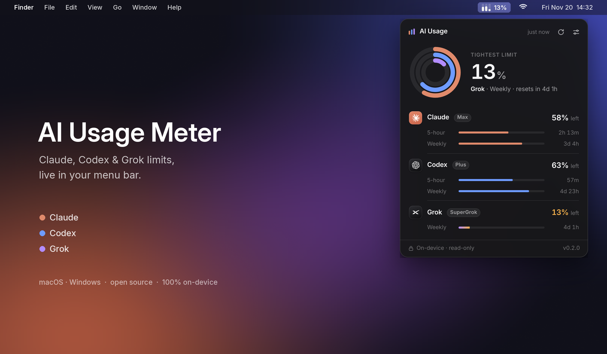
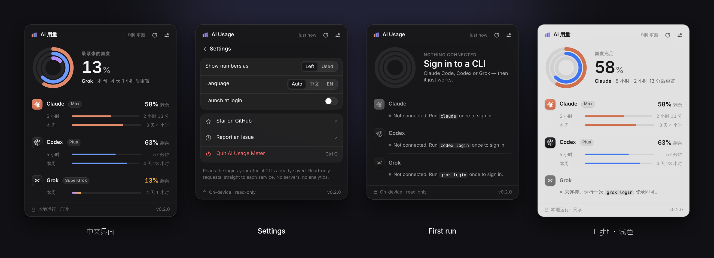

<div align="center">


# AI Usage Meter

**Your Claude, Codex and Grok limits — live in the menu bar.**

[中文](./README.md) · English

[](https://github.com/TTNAN/ai-usage-meter/actions/workflows/build.yml)
[](https://github.com/TTNAN/ai-usage-meter/releases)

[](./LICENSE)

<picture>
  <source media="(prefers-color-scheme: light)" srcset="docs/hero-light.png" />
  
</picture>

</div>

Tired of hitting "usage limit reached" mid-task? AI Usage Meter puts every 5-hour window, weekly limit and reset countdown for all three services in your menu bar. **No browser tabs, no pasted cookies, no servers.**

## Highlights

- **See the tightest limit first** — three rings and one big number tell you which quota runs out first and when it resets.
- **The icon is the gauge** — three tiny battery bars show what's left of each quota; on macOS you can show the percentage right next to it.
- **Every window, not just one** — Claude 5-hour / weekly (plus separate Opus and Sonnet limits), Codex 5-hour / weekly, Grok's billing period, each with its own countdown.
- **Plan aware** — picks up Max, Pro, Plus, SuperGrok and friends.
- **Zero setup** — reuses the logins of Claude Code, Codex CLI and Grok Build. Install and go.
- **Feels native** — real macOS popover material, follows light and dark mode, opens from the icon and tucks away when you click elsewhere; a tray flyout on Windows.
- **English and 中文** — follows your system language, switchable in Settings.
- **Calm and honest** — gentle background polling, rate-limited manual refresh; one failed request keeps the last reading (clearly marked) and it never makes numbers up.
- **Tiny** — Tauri v2 and plain HTML/CSS/JS. No Node, no bundler.

<p align="center"></p>

## Install

Grab the latest build from [Releases](https://github.com/TTNAN/ai-usage-meter/releases):

| Platform | File | Notes |
| --- | --- | --- |
| macOS (Apple silicon + Intel) | `.dmg` | Drag to Applications. Not notarised yet: right-click → Open the first time, or run the command below |
| Windows 10 / 11 | `.exe` or `.msi` | Per-user install, no admin needed |

```bash
xattr -d com.apple.quarantine "/Applications/AI Usage Meter.app"
```

Then sign in to whichever CLIs you use (the rest just show "Not connected"):

| Service | Install | Sign in |
| --- | --- | --- |
| Claude | [Claude Code](https://docs.anthropic.com/en/docs/claude-code) | `claude` |
| Codex | [Codex CLI](https://github.com/openai/codex) | `codex login` |
| Grok | [Grok Build](https://docs.x.ai/build/overview) | `grok login` |

## Shortcuts

| Keys | Action |
| --- | --- |
| `⌘R` / `Ctrl R` | Refresh |
| `⌘,` | Settings |
| `Esc` | Close the popover |
| `⌘Q` / `Ctrl Q` | Quit |

## How it works

None of the three services offers a public "subscription quota" API, so AI Usage Meter reads the same endpoints their official CLIs use, with the login those CLIs already saved on your machine:

| Service | Endpoint | Credential | Polling |
| --- | --- | --- | --- |
| Claude | `GET api.anthropic.com/api/oauth/usage` | macOS Keychain `Claude Code-credentials`, or `~/.claude/.credentials.json` | 5 min |
| Codex | `GET chatgpt.com/backend-api/wham/usage` | `~/.codex/auth.json` (`$CODEX_HOME` respected) | 1 min |
| Grok | `GET cli-chat-proxy.grok.com/v1/billing` | `~/.grok/auth.json` (`$GROK_HOME` respected) | 5 min |

> [!NOTE]
> The Codex row shows your **Codex** quota, not ChatGPT web-chat limits. They are counted separately.

## Privacy

- Credentials are read at request time and sent only to the service they belong to. Never stored, never uploaded.
- Read-only `GET` requests. Your accounts and CLI config files are never modified.
- No servers, no analytics, no telemetry. It's a few hundred lines — read [`providers.rs`](src-tauri/src/providers.rs).

## Caveats

These are unofficial, internal endpoints and can change at any time. If one does, that row says it can't reach the service instead of showing a wrong number; each service's own settings page is the source of truth. Low-frequency read-only polling is low risk and there are no public reports of bans from it, but we can't promise there never will be.

## Contributing

You can work on the UI without Rust: serve `src/` with any static server and it runs as a preview with demo data.

```bash
python3 -m http.server -d src 8000
# http://localhost:8000/?state=empty   first run
# http://localhost:8000/?view=settings settings
```

The desktop app needs Rust stable:

```bash
cargo install tauri-cli --version "^2"
cargo tauri dev                    # develop
cargo tauri build                  # package
cd src-tauri && cargo test         # unit tests
AI_USAGE_METER_MOCK=1 cargo tauri dev   # run with demo data
```

Want another service (Gemini CLI, Cursor, Copilot…)? Open an [issue](https://github.com/TTNAN/ai-usage-meter/issues) or a PR — each service is a single function in `providers.rs`.

## Roadmap

- [ ] Notifications when a limit is about to run out
- [ ] More services: Gemini CLI, GitHub Copilot, Cursor
- [ ] Usage history sparkline
- [ ] Linux tray
- [ ] Signed and notarised macOS builds

## Thanks

- [@Litx4i](https://x.com/Litx4i/status/2123400444458488080) — the original idea
- [Quota](https://github.com/josephbergvinson/quota) — the reuse-the-CLI-login approach

If it saved you from one "limit reached" surprise, a ⭐️ helps it keep getting better.

## License and trademarks

[MIT](./LICENSE). Claude is a trademark of Anthropic; OpenAI / ChatGPT / Codex are trademarks of OpenAI; Grok / xAI are trademarks of xAI. Brand marks only identify each service and imply no endorsement. Screenshots use demo data.
